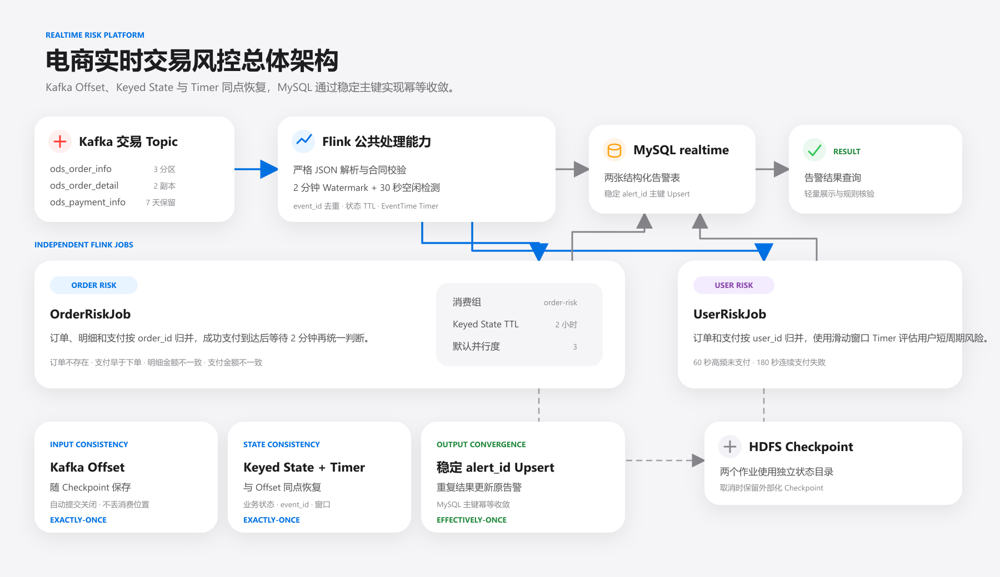
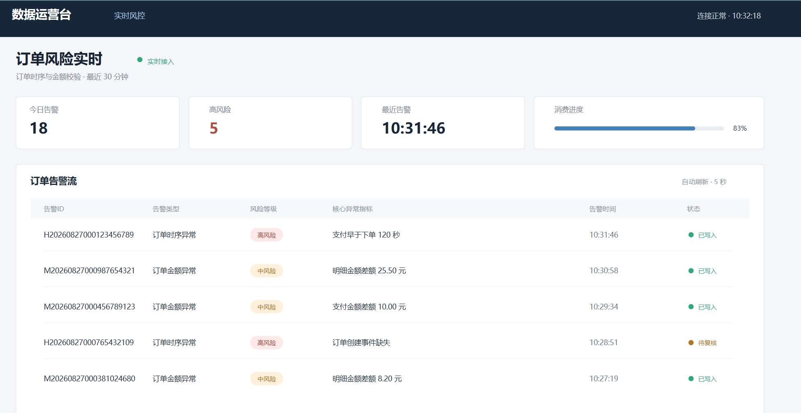
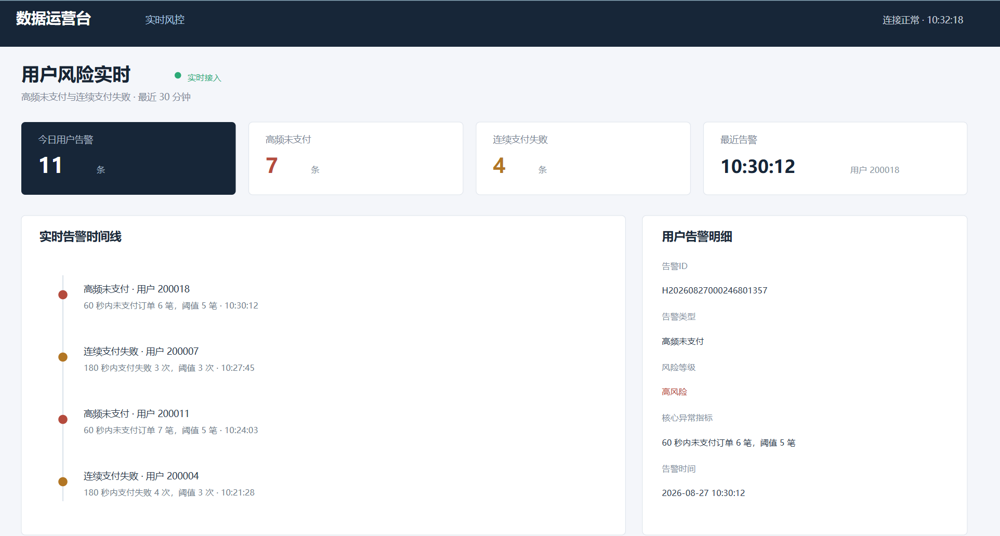
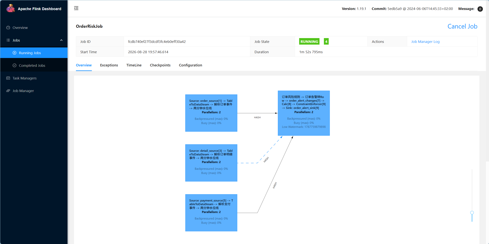
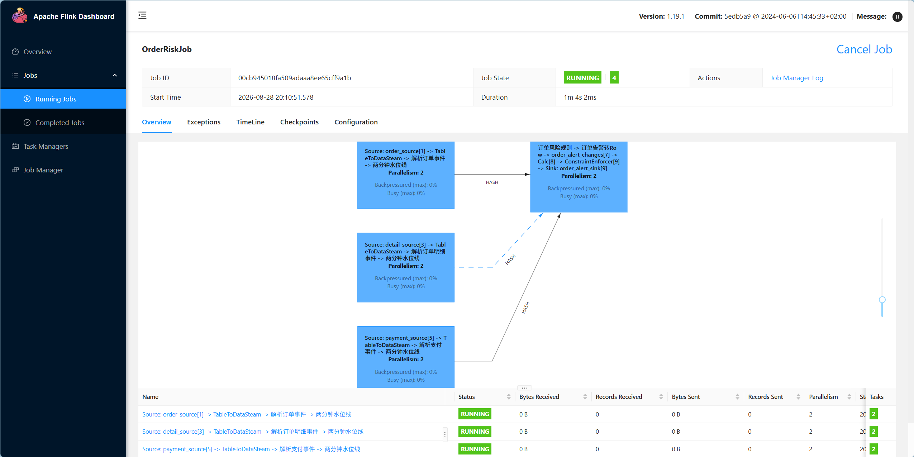

# 电商实时交易风控

基于 **Kafka、Flink 和 MySQL** 的电商交易风控项目。消费订单、订单明细和支付事件，识别订单时序、金额一致性与用户短周期行为风险，将结构化告警写入 MySQL。

**技术栈：** Java 17 · Flink 1.19.1 · Kafka · MySQL 8.x · HDFS · Maven

[总体架构](#总体架构) · [风险规则](#风险规则) · [结果展示](#结果展示) · [代码导航](#代码导航) · [详细设计](docs/design.md)

关联项目：[电商离线数仓与经营分析](https://github.com/jwdghmld/offline_warehouse)。交易事件由该仓库的造数器在 MySQL 事务提交成功后发布。

## 总体架构



```text
Kafka 订单 / 明细 / 支付事件
  ├── OrderRiskJob → 按 order_id 聚合 → 订单时序与金额校验
  └── UserRiskJob  → 按 user_id 聚合  → 用户短周期风险检测
                         ↓
                 MySQL 结构化告警表
```

两个作业使用独立消费组和 Checkpoint 目录。Flink SQL 定义输入与输出表，DataStream API 负责事件时间、Keyed State 和 Timer。

## 风险规则

| 作业 | 风险项 | 判断依据 |
|---|---|---|
| 订单风险 | 订单不存在 | 成功支付对应的事件时间 Timer 触发后，仍没有订单创建事件 |
| 订单风险 | 支付早于下单 | 支付时间早于订单创建时间 |
| 订单风险 | 明细金额不一致 | 明细成交金额合计与订单金额不一致 |
| 订单风险 | 支付金额不一致 | 成功支付金额与订单金额不一致 |
| 用户风险 | 高频未支付 | 60 秒窗口内未支付订单数大于 5 |
| 用户风险 | 连续支付失败 | 180 秒窗口内失败支付次数大于等于 3 |

订单判断在成功支付时间后 2 分钟的事件时间 Timer 上执行。用户规则采用 10 秒滑动步长、180 秒冷却时间；未支付规则额外等待 2 分钟的事件时间，以等待跨 Topic 到达的成功支付。

“连续支付失败”是当前规则名称，实现按窗口内失败次数累计，不要求失败事件在序列中连续。

## 核心设计

| 关注点 | 实现方式 |
|---|---|
| 跨 Topic 乱序 | 2 分钟有界乱序 Watermark、30 秒空闲分区检测与 EventTime Timer |
| 输入重复 | 在状态有效期内按稳定 `event_id` 去重 |
| 状态管理 | 订单状态 TTL 为 2 小时，用户状态 TTL 为 10 分钟，配合业务完成后的主动清理 |
| 故障恢复 | Checkpoint 保存 Kafka 消费位置、Keyed State 与 Timer 的一致恢复点 |
| 输出重复 | 稳定 `alert_id` 作为 MySQL 主键，通过 JDBC Upsert 收敛重复写入 |

**一致性边界：** Flink 状态使用 Exactly-Once Checkpoint；MySQL 输出依赖稳定主键实现幂等写入，不声明端到端事务精确一次。当前实现记录迟到事件，但不回撤已经输出的告警。完整机制见[代码级设计](docs/design.md)。

## 结果展示

| 结果表 | 展示内容 |
|---|---|
| `realtime.rt_order_risk_alert` | 订单风险项、等级、订单与支付标识、金额差额或时间差 |
| `realtime.rt_user_risk_alert` | 用户风险项、窗口结束时间、实际次数与规则阈值 |

以下截图展示告警表的页面呈现；本仓库包含风险计算与告警写入代码，页面实现未包含在内。

### 订单风险



<details>
<summary>查看用户风险结果</summary>



</details>

<details>
<summary>查看两个作业的 Flink Web UI 截图</summary>

### 订单风险作业



### 用户风险作业



</details>

## 代码导航

| 想了解什么 | 代码入口 |
|---|---|
| 订单聚合、状态与四条规则 | [OrderRiskJob.java](flink/src/main/java/com/ecommerce/realtime/job/OrderRiskJob.java) |
| 用户滑动窗口与冷却机制 | [UserRiskJob.java](flink/src/main/java/com/ecommerce/realtime/job/UserRiskJob.java) |
| 输入字段与业务校验 | [EventParsers.java](flink/src/main/java/com/ecommerce/realtime/sql/EventParsers.java) |
| 统一事件模型 | [RiskEvent.java](flink/src/main/java/com/ecommerce/realtime/model/RiskEvent.java) |
| 作业配置与状态目录 | [RealtimeConfig.java](flink/src/main/java/com/ecommerce/realtime/config/RealtimeConfig.java) |
| 告警表结构 | [03_realtime.sql](contracts/mysql/03_realtime.sql) |
| 规则与时间工具测试 | [flink/src/test/](flink/src/test/) |

```text
realtime_risk/
├── flink/                 # Maven 工程：两个作业、公共模型与单元测试
├── contracts/             # Kafka 事件合同与 MySQL 告警表 DDL
├── config/                # 环境变量模板
├── kafka/                 # Topic 创建脚本
├── samples/events/        # 订单、明细与支付 JSONL 样例
├── docs/                  # 详细设计与项目截图
└── .github/workflows/     # Maven 测试打包与 Shell 语法检查
```

## 相关文档

- [实时风控代码级设计](docs/design.md)：状态、Timer、窗口、告警主键与一致性边界。
- [Kafka 交易事件合同](contracts/kafka/topic-contract.md)：与离线仓库共享的 `1.0.0` 版本合同。
- [配置说明](docs/deployment.md)。
