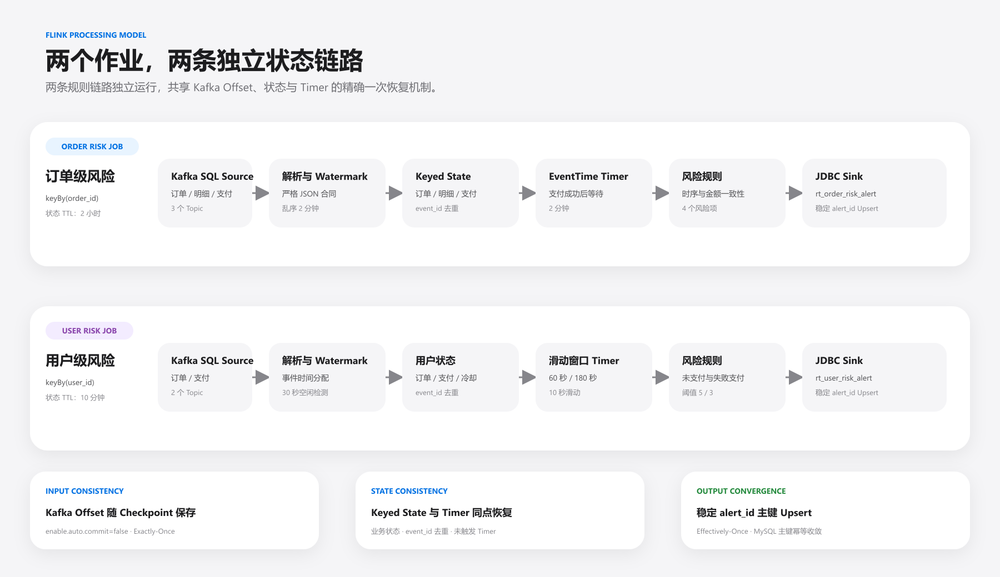

# 实时风控代码级设计

[返回项目首页](../README.md)

本文集中说明两个作业的状态、窗口与输出一致性设计。风险规则、结果展示和代码入口见项目首页。

## 技术栈

| 分类 | 技术与版本 | 用途 |
|---|---|---|
| 开发语言 | Java 17 | 实现两个 Flink 风控作业与测试 |
| 实时计算 | Apache Flink 1.19.1 | 事件时间、状态、Timer、Checkpoint 和 Table/DataStream 混合处理 |
| 消息系统 | Kafka Connector 3.3.0-1.19 | 消费三个交易 Topic |
| 输入格式 | Flink JSON Format | 严格解析并校验消息字段 |
| 结果存储 | MySQL 8.x、Flink JDBC Connector 3.2.0-1.19 | Upsert 两张结构化告警表 |
| 状态存储 | HDFS 3.3.4 | 保存 Checkpoint 与外部化恢复状态 |
| 构建测试 | Maven、JUnit 5.10.3 | 依赖管理、打包和规则单元测试 |
| 时间标准 | Asia/Shanghai | 统一事件时间、告警日期和 MySQL 时间语义 |

## Kafka 输入合同

合同版本为 `1.0.0`。三个 Topic 均为 3 分区、默认 2 副本、保留 7 天，消息 Key 为十进制字符串形式的 `order_id`，Value 为 UTF-8 JSON。

| Topic | 事件类型 | 业务粒度 | 被哪个作业消费 |
|---|---|---|---|
| `ods_order_info` | `ORDER_CREATED` | 一次订单创建 | 订单风险、用户风险 |
| `ods_order_detail` | `ORDER_DETAIL` | 一条订单商品明细 | 订单风险 |
| `ods_payment_info` | `PAYMENT_SUCCESS`、`PAYMENT_FAILED` | 一次支付尝试 | 订单风险、用户风险 |

所有消息包含稳定 `event_id`、`event_type`、`event_time` 和 `business_date`。金额直接映射为 `DECIMAL(20,2)`，避免经过 Double 产生精度损失。完整字段、示例和发布约束见 [`contracts/kafka/topic-contract.md`](../contracts/kafka/topic-contract.md)。

## 类职责

| 类 | 职责 |
|---|---|
| `RealtimeConfig` | 统一读取 Kafka、MySQL 和 Checkpoint 环境变量，并为两个作业生成独立配置 |
| `RiskEvent` | 统一承载订单、明细和支付解析后的业务字段 |
| `EventParsers` | 将 Flink SQL Row 严格转换为 `RiskEvent`，校验事件类型、日期、时间和金额 |
| `TimeUtils` | 统一 `Asia/Shanghai` 时间解析、日期转换和格式化 |
| `OrderRiskJob` | 维护订单键状态，等待跨 Topic 事件并执行四条订单规则 |
| `UserRiskJob` | 维护用户键状态，计算两个滑动窗口规则和冷却时间 |

## API 分工

Flink SQL 只负责声明 Kafka Source 与 JDBC Sink，使字段合同和连接器参数集中可读。Table 转为 DataStream 后再完成 Watermark、`keyBy`、Keyed State、Timer 和纯规则函数；告警最终转回 Row 并通过临时视图写入 JDBC Sink。

该边界避免用 SQL Join 直接处理跨 Topic 长时间乱序，也保留了 Table Connector 的声明式配置能力。

## 作业处理链路



## 订单状态机

`OrderRiskProcessFunction` 按 `order_id` 保存一个订单快照、多个明细、多个支付尝试和已处理事件集合。只有成功支付注册 `payment_time + 2min` 的 Timer；失败支付保留在输入合同中，但不会触发订单金额判断。

Timer 触发时按业务键找到对应成功支付，累计全部明细成交金额，调用无状态 `evaluate` 函数生成零到多条违规结果。`evaluate` 不访问 Flink Runtime，便于直接单元测试。完成判断后清除订单、明细和支付状态，去重状态由 TTL 回收。

## 用户窗口实现

`UserRiskProcessFunction` 没有使用窗口算子，而是显式计算事件所属的全部窗口结束点并注册 Timer：

```text
窗口结束点 = floor(event_time / slide) * slide + slide + n * slide
窗口数量   = window_size / slide
```

未支付窗口为 60 秒，在窗口结束后 120 秒的事件时间 Timer 上判断；失败支付窗口为 180 秒，在对应窗口结束点判断。两类窗口都以 10 秒滑动，并分别保存已评估窗口与冷却结束时间，控制重复评估和相邻窗口的重复告警。规则名“连续支付失败”对应窗口内失败次数累计，不要求序列连续。

## 事件时间与乱序处理

本项目只使用消息中的 `event_time` 推进业务时间，不以机器处理时间替代事件时间。

| 机制 | 配置 | 作用 |
|---|---:|---|
| 有界乱序 Watermark | 2 分钟 | 容忍 Kafka 分区和跨 Topic 的正常乱序 |
| 空闲分区检测 | 30 秒 | 防止无数据分区长期阻塞全局 Watermark |
| 订单判断等待 | 成功支付后 2 分钟 | 等待订单与明细补齐后再检查 |
| 未支付额外等待 | 窗口结束后 2 分钟 | 等待可能迟到的成功支付事件 |
| 状态 TTL | 订单 2 小时、用户 10 分钟 | 控制状态长期增长 |
| 迟到指标 | `late_events` | 记录已落后于当前 Watermark 的事件 |

当事件时间不大于当前 Watermark 时，作业记录日志和 `late_events` 指标，随后仍进入状态处理；当前实现不回撤已输出告警。Timer 的触发取决于 Watermark 推进，2 分钟等待表示事件时间间隔。

## 状态生命周期

- 订单状态 TTL 为 2 小时，用户状态 TTL 为 10 分钟。
- TTL 在创建和写入时刷新，过期状态不可见。
- 业务计算完成后优先主动清理，TTL 作为异常路径和残留状态的兜底。
- 迟于当前 Watermark 的事件增加 `late_events` 指标并记录业务标识。

## 去重与主键

输入去重键为合同中的稳定 `event_id`，去重有效期受状态 TTL 限制。输出 `alert_id` 由风险等级前缀、业务日期和稳定业务键的 SHA-256 摘要生成 12 位编号：

```text
订单告警：level + yyyyMMdd + hash(order_id, payment_id, rule_code)
用户告警：H     + yyyyMMdd + hash(user_id, window_end, rule_code)
```

主键只依赖业务事实，不依赖 TaskManager、并行子任务或处理时间。重复消息与恢复重放因此会命中相同 MySQL 主键。

## 精确一次状态恢复

两个作业均以 `CheckpointingMode.EXACTLY_ONCE` 每 60 秒生成恢复点。Kafka Source 的消费位置、Keyed State、去重集合和 EventTime Timer 属于同一个 Checkpoint；只有完整成功的 Checkpoint 才成为新的恢复基线。

```text
Checkpoint N
├── Kafka Offset
├── 订单或用户业务状态
├── processed-events 去重状态
├── 窗口与冷却标记
└── 尚未触发的 EventTime Timer
```

发生故障时，作业不会分别恢复这些对象，而是从同一个成功 Checkpoint 整体恢复。这保证消费位置与规则上下文同步回退，避免 Offset 已确认但业务状态丢失。

## 输出提交边界

MySQL 已成功写入告警、但对应 Checkpoint 尚未完成时，如果作业发生故障，恢复后的相同输入可能再次触发同一条告警。输出侧通过稳定主键设计处理该故障窗口。

项目通过三层机制收敛该重复：

1. `event_id` 在 Flink 状态中控制同一恢复周期内的输入重复。
2. `alert_id` 由稳定业务键生成，恢复重放不会改变结果主键。
3. MySQL 以 `alert_id` 为主键执行 Upsert，重复提交更新原记录。

该方案由两部分组成：Kafka Offset、Flink 状态和 Timer 提供 **Exactly-Once State Recovery**，稳定业务主键与 MySQL Upsert 提供 **Idempotent Effectively-Once**，共同保证故障恢复后的风险结果一致性。

## 故障窗口

| 故障点 | Offset | 状态与 Timer | MySQL 结果 |
|---|---|---|---|
| Checkpoint 前失败 | 回退 | 回退 | 未写入或由稳定主键收敛 |
| Checkpoint 完成后失败 | 从新一致点恢复 | 从新一致点恢复 | 已确认结果保持 |
| JDBC 成功、Checkpoint 失败 | 回退后重放 | 回退后重算 | 可能重复 Upsert，但不新增重复主键 |
| 取消作业 | 取决于恢复入口 | 外部化 Checkpoint 保留 | 历史结果不删除 |

## Checkpoint 参数与恢复配置

```text
Checkpoint 周期：60 秒
Checkpoint 模式：Exactly-Once
Checkpoint 超时：10 分钟
最小间隔：30 秒
最大并发：1
取消策略：保留外部化 Checkpoint
失败重启：最多 3 次，每次间隔 30 秒
默认并行度：3
```

两个作业分别使用 `order-risk` 和 `user-risk` 消费组，并写入独立 Checkpoint 子目录。Checkpoint 成功后形成新的恢复一致点；失败的 Checkpoint 不会推进恢复基线。故障窗口与输出边界见前文对应章节。

## MySQL 结果表

| 表名 | 结果粒度 | 主要用途 |
|---|---|---|
| `realtime.rt_order_risk_alert` | 一行一条订单风险项 | 查询异常订单、风险类型、金额差额和时间差 |
| `realtime.rt_user_risk_alert` | 一行一个用户在窗口结束点产生的风险 | 查询短周期行为次数、阈值和风险时间 |

两张表均以 `alert_id` 为主键，并按日期、类型、等级和业务实体建立查询索引。DDL 还包含风险类型、等级、计数、日期和更新时间等约束，用于阻止不符合规则的结果进入服务表。

JDBC Sink 每 100 行或 1 秒触发一次缓冲刷新，失败最多重试 3 次。稳定主键确保同一告警再次写入时更新原记录，而不是新增重复行。

## 资源与作业隔离

```text
默认并行度 = 3
建议 TaskManager = 2
建议每个 TaskManager Slot = 3
order-risk 消费组 -> order-risk Checkpoint 子目录
user-risk 消费组  -> user-risk Checkpoint 子目录
```

两个作业可以独立提交、停止和恢复。一侧规则故障不会共享另一侧的 Keyed State 或消费进度；公共部分仅限 Kafka 合同、事件模型、解析器、时间工具和基础配置读取方式。

## 测试边界

单元测试覆盖订单四类违规判断、用户窗口归属和计数逻辑，以及时区和日期转换。Kafka Connector、Checkpoint 恢复与 MySQL JDBC 行为属于集成验证范围，应在与目标集群版本一致的环境中执行。
